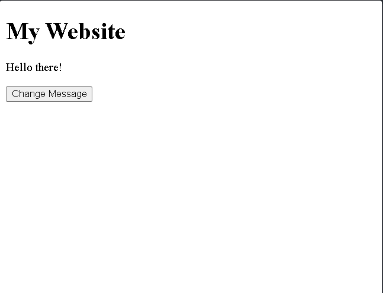
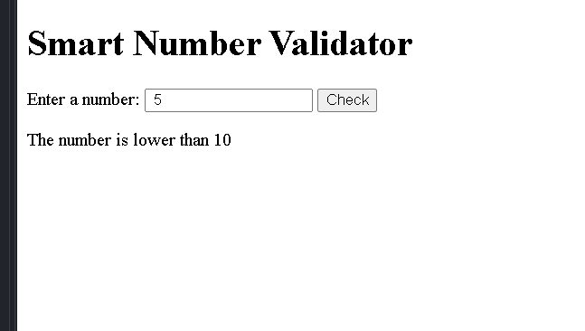
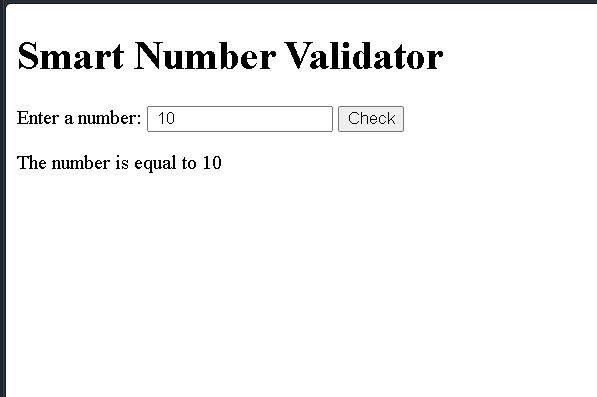
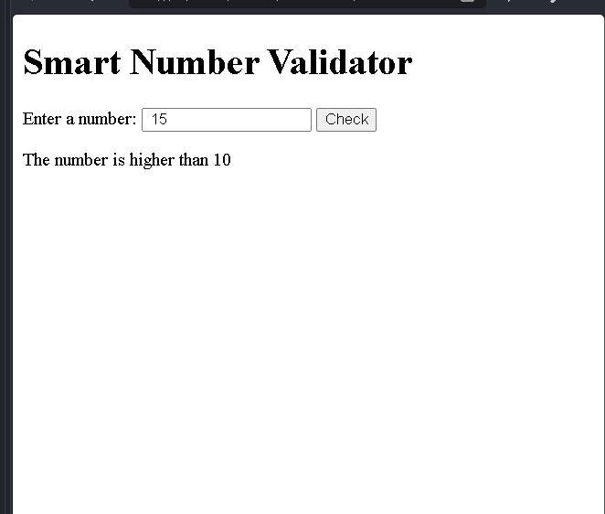
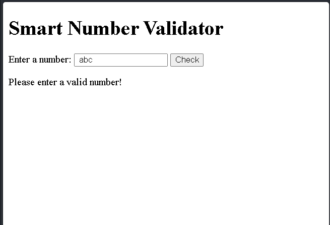
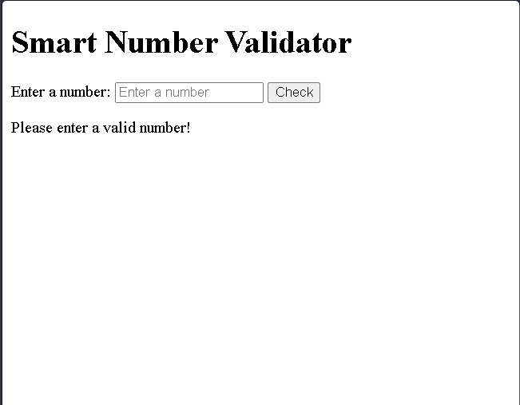
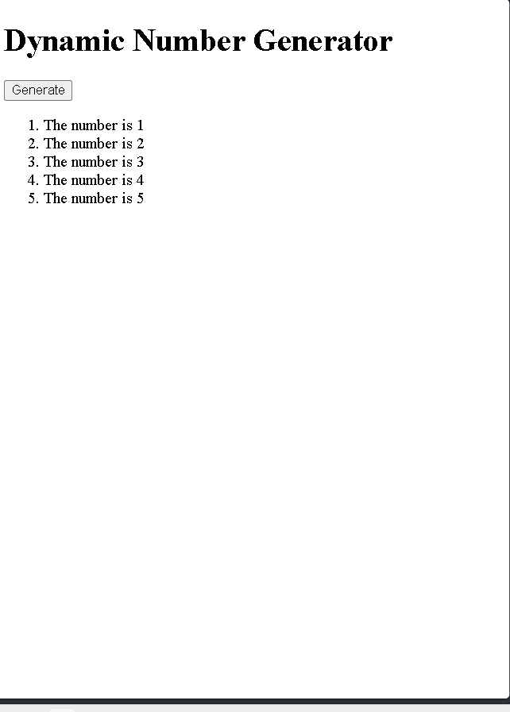

# BIC21203 Web Development
## Lab 4a: Client-Side Scripting (JavaScript)

### Student Information

- **Name:** Mohamed Hassan Ibrahim
- **Student ID:** BI230051
- **Course:** BIC21203 Web Development
- **Academic Session:** 2026/2027

---

## 1. Introduction

This laboratory focuses on client-side scripting using JavaScript. The main objective is to develop interactive webpages using JavaScript functions, event handling, input validation, loops, and DOM manipulation.

## 2. Question 1 – Interactive Text Changer

This task involves creating a webpage that changes a paragraph when the user clicks a button.

**Implementation:**
- Selected HTML elements using JavaScript DOM methods.
- Created a function named `changeMessage()`.
- Used `textContent` to replace the original message.
- Used `addEventListener()` to handle button clicks.

**Expected Output:**
The original message "Welcome to my website!" changes to "Hello there!" when the button is clicked.

**Files:**
- q1.html
- q1.js

## 3. Question 2 – Smart Number Validator

This task involves creating an interactive webpage that accepts a number and displays a validation message.

**Implementation:**
- Created a function named `checkInput()`.
- Used `Number()` to convert input into a number.
- Used `if...else if...else` conditions.
- Handled empty and invalid inputs.
- Used `textContent` to display the results.

**Test Cases:**

| Input | Expected Result |
|---|---|
| 5 | The number is lower than 10 |
| 10 | The number is equal to 10 |
| 15 | The number is higher than 10 |
| abc | Please enter a valid number! |
| Empty | Please enter a valid number! |

**Files:**
- q2.html
- q2.js

## 4. Question 3 – Dynamic Number Generator

This task involves generating an ordered list containing numbers from 1 to 5 when the user clicks the Generate button.

**Implementation:**
- Created a function named `generateNumbers()`.
- Used a `for` loop to generate numbers from 1 to 5.
- Used `document.createElement()` to create list items.
- Used `textContent` to set the text.
- Used `appendChild()` to add list items.
- Cleared existing items before generating a new list.

**Expected Output:**
An ordered list displaying "The number is 1" through "The number is 5", without duplicate items after repeated clicks.

**Files:**
- q3.html
- q3.js

## 5. How to Run the Programs

1. Download or clone this GitHub repository.
2. Open the project folder using Visual Studio Code.
3. Open q1.html, q2.html, or q3.html in a web browser.
4. Click the buttons to test the functionality of each webpage.

 
 ## 6. Screenshots of Outputs

### Question 1 – Interactive Text Changer

### Question 2 – Smart Number Validator

### Question 3 – Dynamic Number Generator

## 7. Conclusion and Reflection

Through this laboratory, I gained practical experience in JavaScript programming and DOM manipulation. I learned how to use functions and event listeners to make webpages interactive. I also improved my understanding of conditional statements, input validation, and for loops. Overall, this laboratory helped me understand how JavaScript can be used to develop dynamic and interactive webpages.
